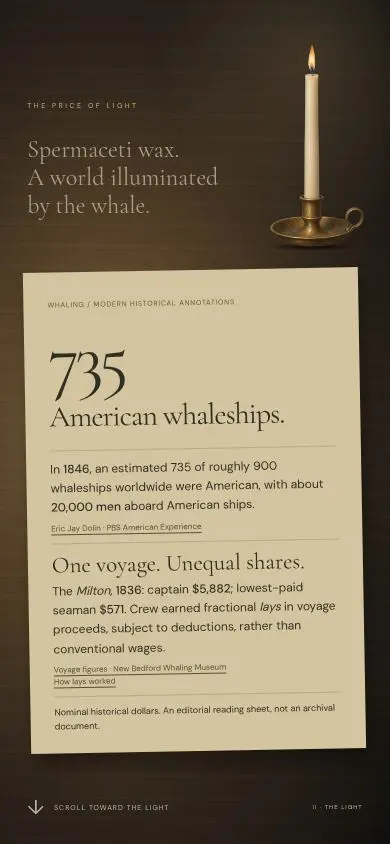
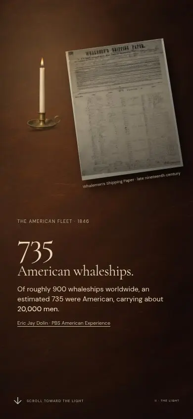
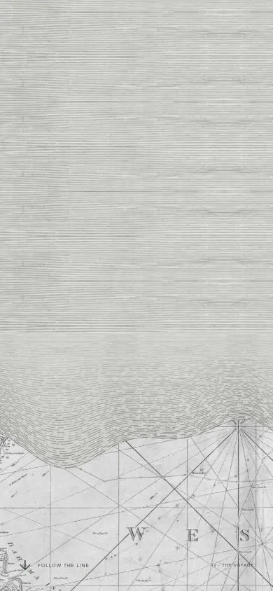

# Harbor and candlelit desk review

Actual Chromium phone captures at 390 × 844. The source agreement is a later nineteenth-century reference from the Nickerson Archives. The desktop surface is an original generated material image. See the source notes for the exact reference and rights assessment.

| Previous desk | Revised desk |
| --- | --- |
|  |  |

[Watch the mobile recording](motion-mobile.webm). The recording shows autonomous creature motion, candle approach, sequential annotations, quotations, the wave transition, and reversal. Travel is accelerated between checkpoints for review. Browser emulation covers desktop, phone, narrow phone and landscape. Physical phones and Safari remain unverified.
