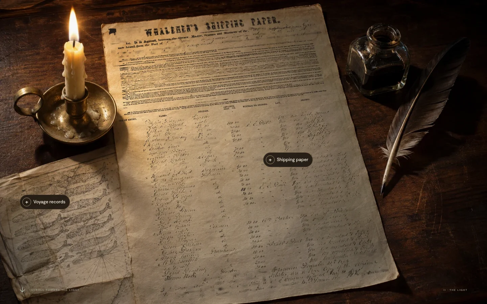

# The candlelit writing desk

Follow the flame to the desk, then select **Shipping paper** or **Voyage records**. Each opens a scan, a short transcription and its historical context. Close the reader or press Escape to resume at the same place.

[Watch the 15-second phone recording](phone-descent.webm) to follow the approach, open the agreement, continue to the harbor and scroll back to the desk.

| Scroll position | Desktop | Phone |
| --- | --- | --- |
| Previous desk | [Before](previous-desktop.webp) | [Before](previous-phone.webp) |
| Approaching the flame | [Desktop](desktop-approach.webp) | [Phone](phone-approach.webp) |
| Desk at rest | [Desktop](desktop-desk.webp) | [Phone](phone-desk.webp) |
| Inspecting the agreement | [Desktop](desktop-inspection.webp) | [Phone](phone-inspection.webp) |
| Leaving for the harbor | [Desktop](desktop-departure.webp) | [Phone](phone-departure.webp) |

[Compare the engraved gulls before and after the paper was removed from their wings.](gulls.webp)

The desk is an illustrated reconstruction. The agreement is a later nineteenth-century example from a volume with an adjacent 1887 endorsement. The secondary sheet draws on the illustrated log of the *Indian Chief*, 1842–44. [Artwork and archival sources](../../asset-sources.md)
