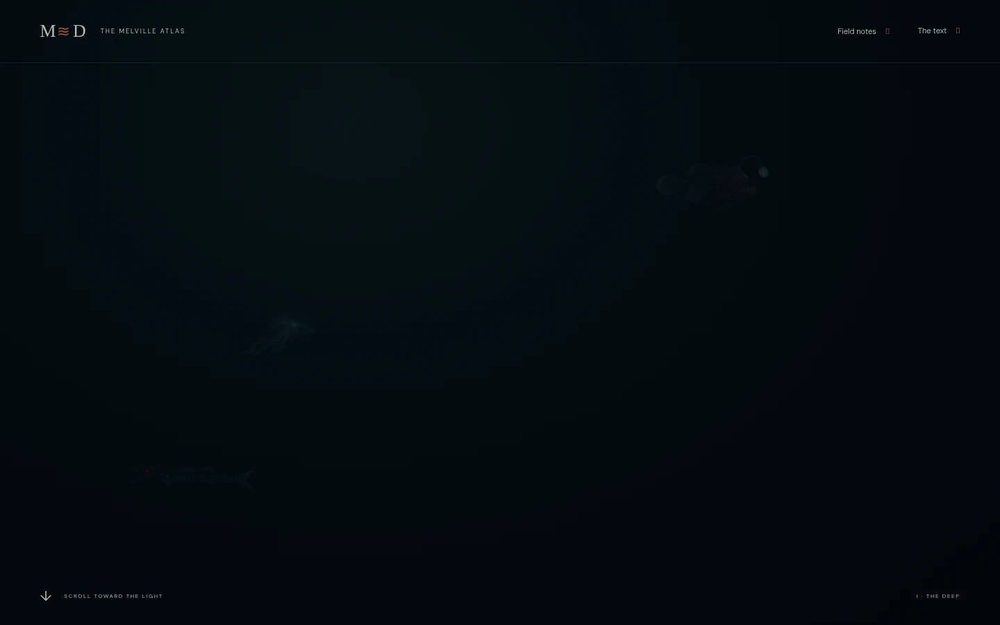
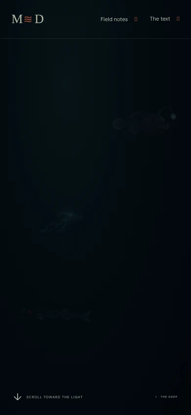
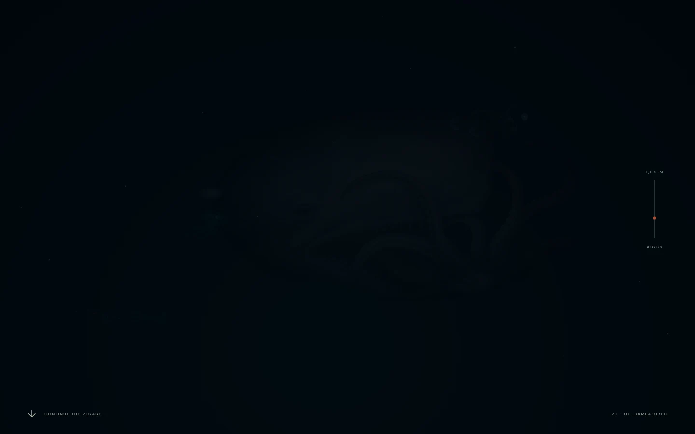
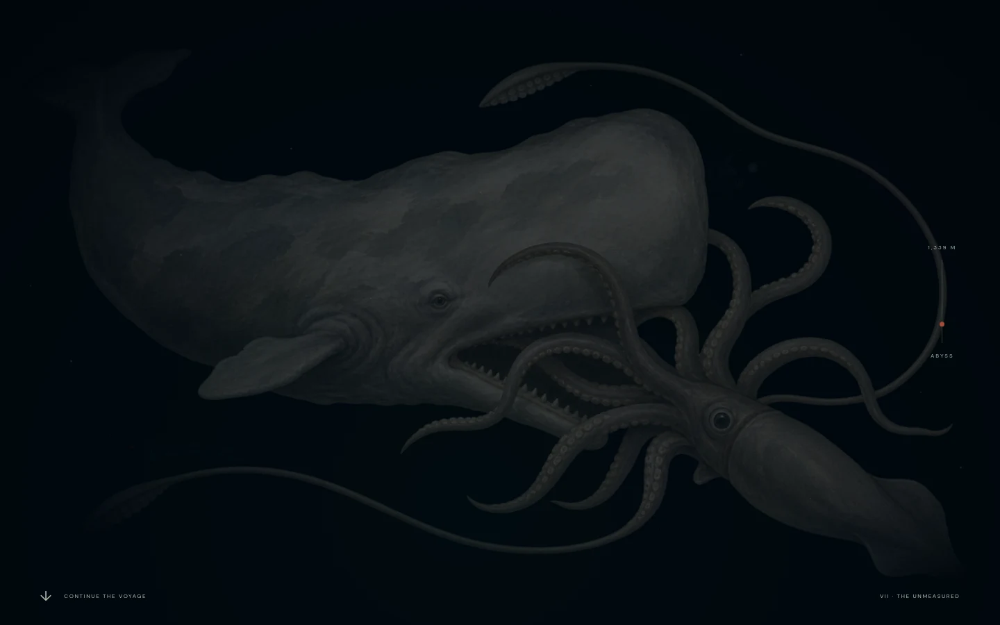
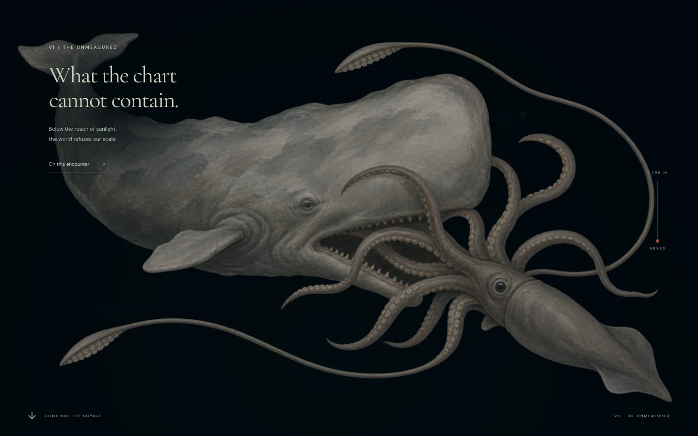
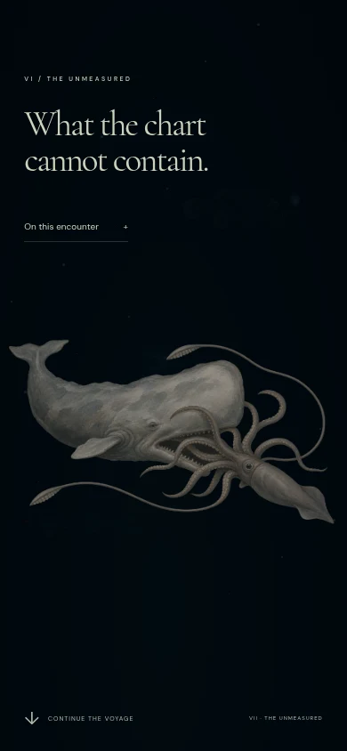

# Issue 14 rendered review

Actual Chromium screenshots at 1440×900 and 390×844, captured at intended display brightness. The opening is deliberately almost black; the lights should be the first legible details. Encounter checkpoints are normalized narrative progress 0.89 (contours), 0.925 (forms), and 1 (complete low-light painting).

For the playable review, download **issue14-browser-review** from the PR's successful GitHub Actions build, unzip, and open `moby-dick-issue14-preview.html` in a browser. This standalone file embeds images and fonts and requires no server. It is a review artifact; the public production site has not changed. Alternatively check out the feature branch, run `npm ci` then `npm run dev`.

Short desktop/mobile recordings are supplied with the session's review artifacts. This is browser emulation, not physical-phone or Safari validation. Reduced motion and keyboard reading paths remain available.
